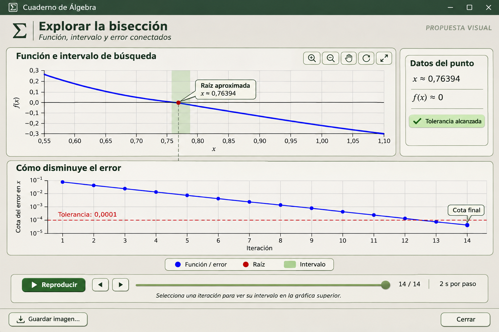
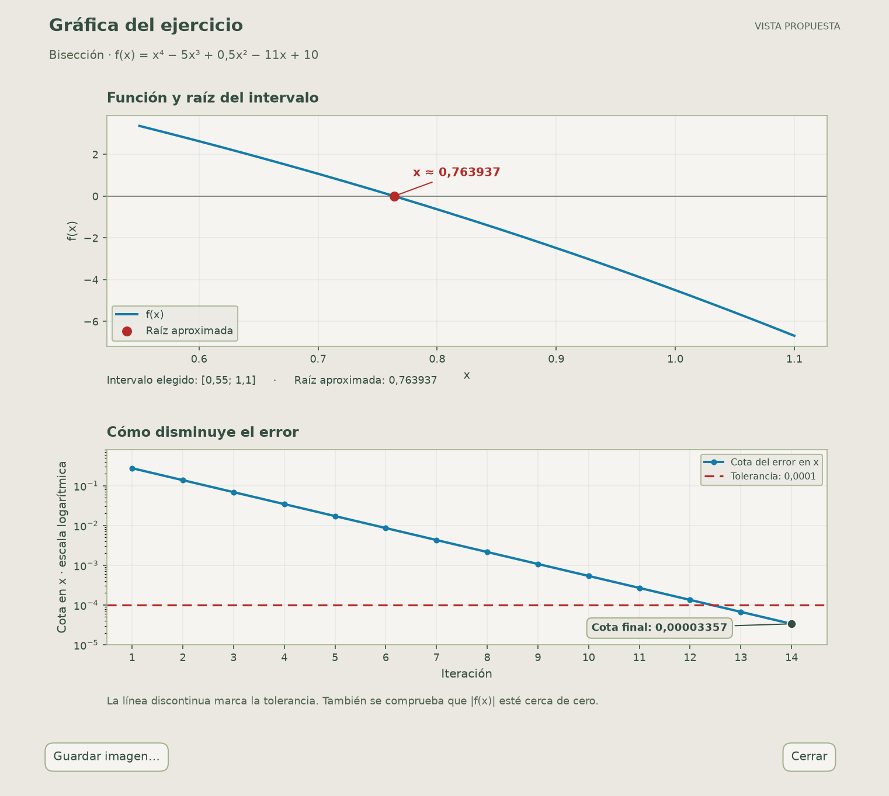
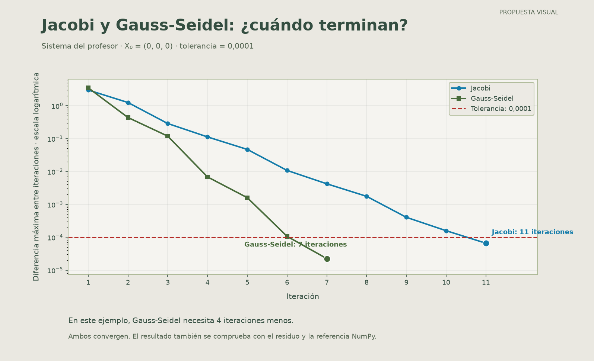
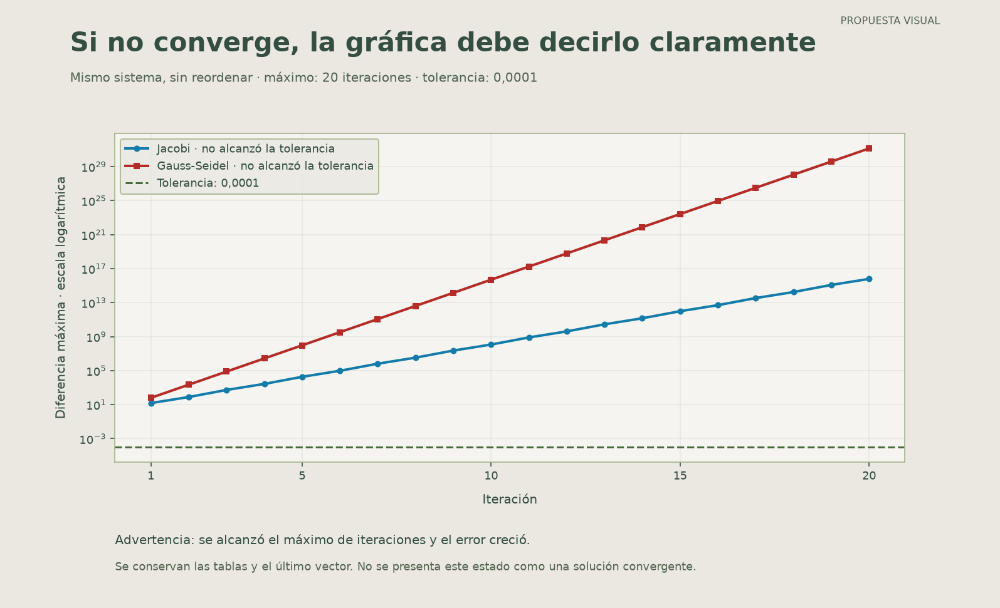
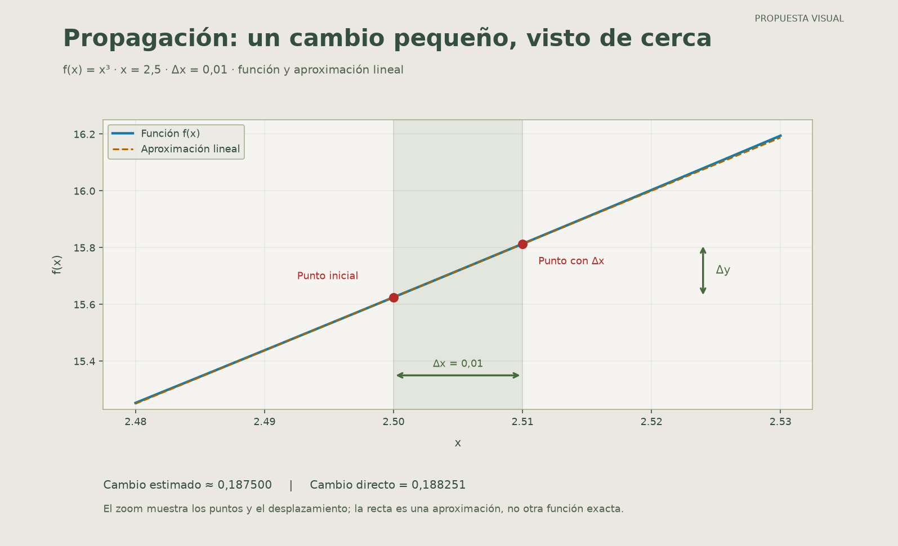
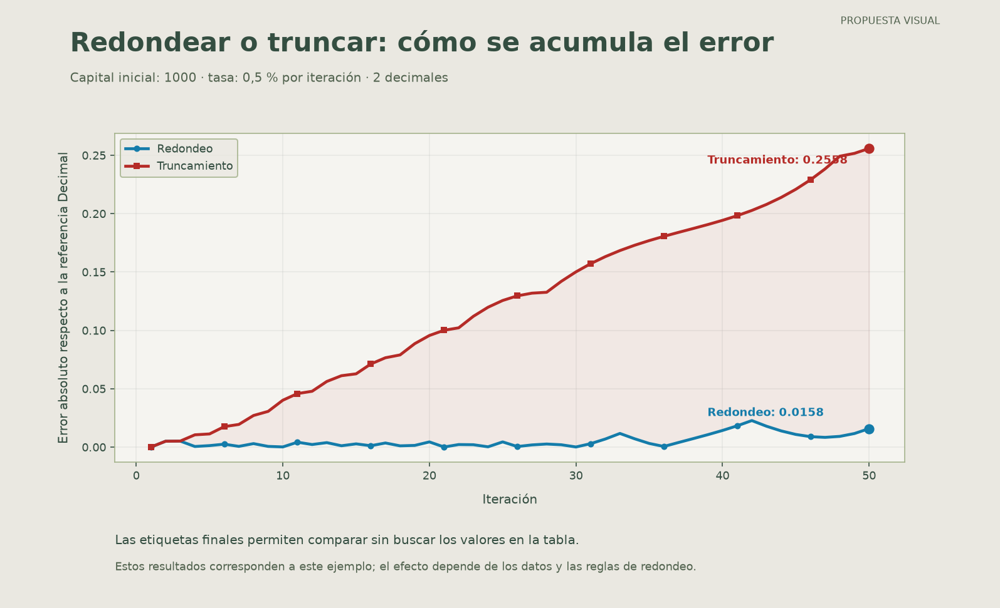
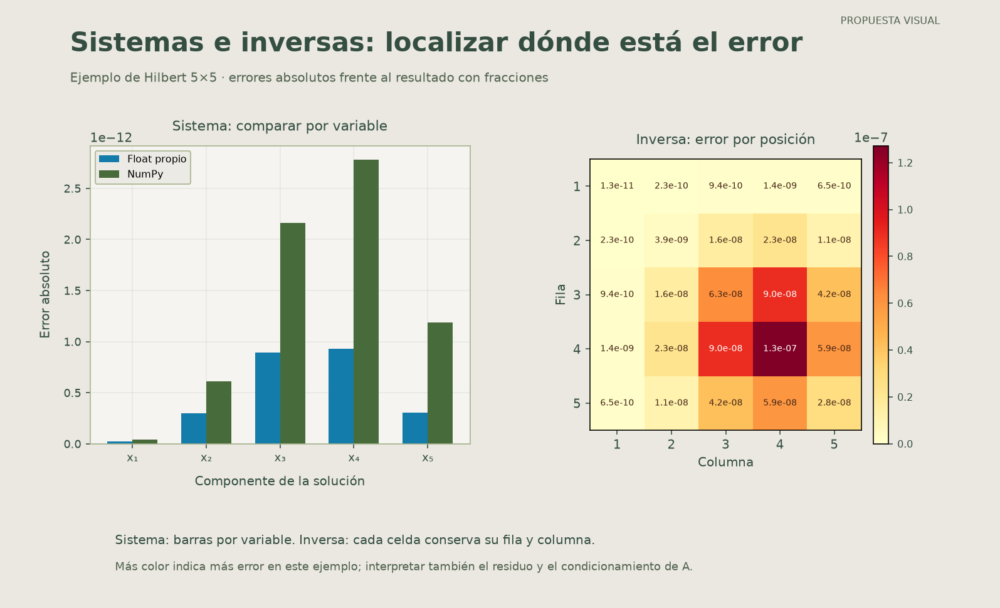

# Referencias visuales de gráficas

Propuestas solicitadas por Reynaldo el 17 de noviembre de 2026 para planificar mejoras por gráfica. No representan funcionalidades implementadas ni autorizan cambiar los algoritmos.

La maqueta interactiva se generó con IA y orienta la composición. Sus curvas, escalas o etiquetas pueden ser ilustrativas: la implementación debe usar los cálculos reales. Las otras imágenes se renderizaron por separado con datos de ejemplos del proyecto; tampoco son capturas de una interfaz ya integrada.

Conservar la paleta vigente, la separación cálculo/interfaz, los pasos completos y el ritmo manual de 2 segundos. Alcance de comprobaciones: Windows con Python 3.11 y 3.13. Cada implementación sigue issue → rama → pruebas → PR → revisión humana.

## Bisección interactiva: función e intervalo conectados al error

## Jacobi: tolerancia, selección de iteraciones y estado final

## Gauss-Seidel: recorrido del error y avisos de relajación

## Comparador Jacobi/Gauss-Seidel: dos curvas y recorrido sincronizado

## Propagación del error: zoom, Δx/Δy y aproximación lineal

## Redondeo y truncamiento: contraste y valores finales

## Sistemas: comparar el error por variable y método

## Inversas: mapa del error por fila y columna

