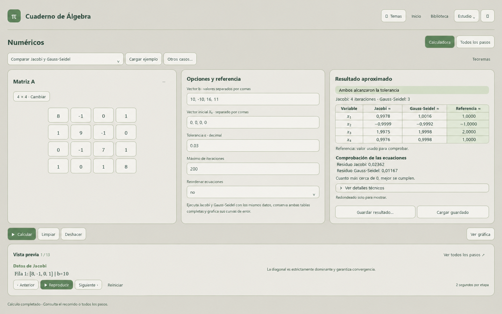
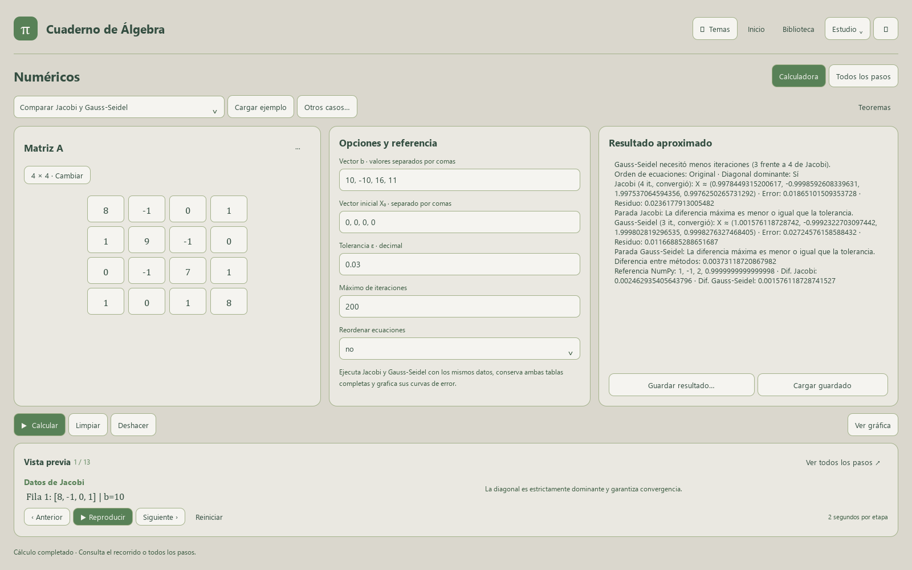

# Resultados más fáciles de leer

Propuesta del 17 de noviembre de 2026, planificada en [#32](https://github.com/ReynaldoZr/AlgebraCalcuadora/issues/32). Implementación asignada a Roberto (@roberto7503), revisión humana de Reynaldo.

La mejora afecta a la tarjeta de resultados: comparar aproximaciones en una tabla, separar referencia y residuo, acortar los números solo al mostrar y mantener los detalles técnicos disponibles. Las advertencias críticas deben permanecer visibles. Conservar las tres tarjetas y la navegación actual.

Las imágenes son maquetas generadas por IA, no capturas de la calculadora ni pruebas numéricas. Los valores y recuentos definitivos salen de los cálculos reales; la imagen no determina la cantidad de pasos. NumPy proporciona una referencia aproximada, no un valor real exacto por definición.

## Referencia principal · mismo diseño, solo resultados

Reynaldo precisó que debe mantenerse el diseño ya establecido. Esta versión parte de una imagen de la calculadora actual renderizada en una instancia aislada: se propone editar solo el contenido del resumen de la tarjeta derecha. Conservar encabezado, tarjetas, márgenes, tipografía, botones, matriz, opciones, navegación y vista previa. No copiar variaciones de estilo que pueda introducir la generación de imágenes.

## Diseño actual antes del cambio · comparación

## Bocetos anteriores sustituidos

[Vista completa anterior](calculadora-resultados-simples.png) y [tarjeta ampliada anterior](tarjeta-resultados-simples.png) se conservan como historial. No usar sus cabeceras, iconos, proporciones ni estilos como instrucciones de rediseño. La versión v2 anterior es la referencia principal de esta issue.

Ver criterios, datos de comprobación y pruebas de Windows en la issue. Esta publicación solo conserva las referencias; no implementa el rediseño ni cambia los algoritmos.
