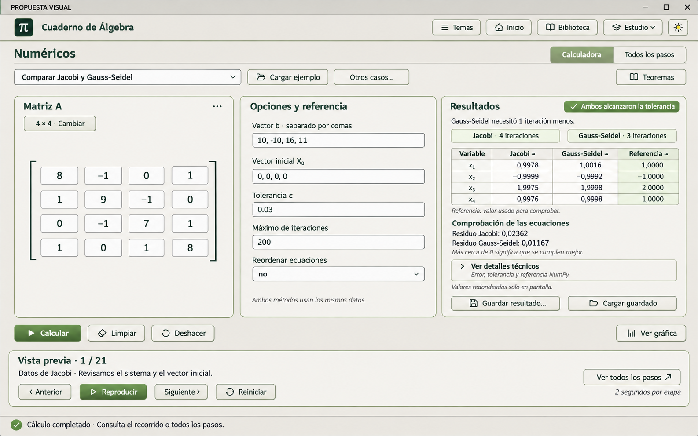
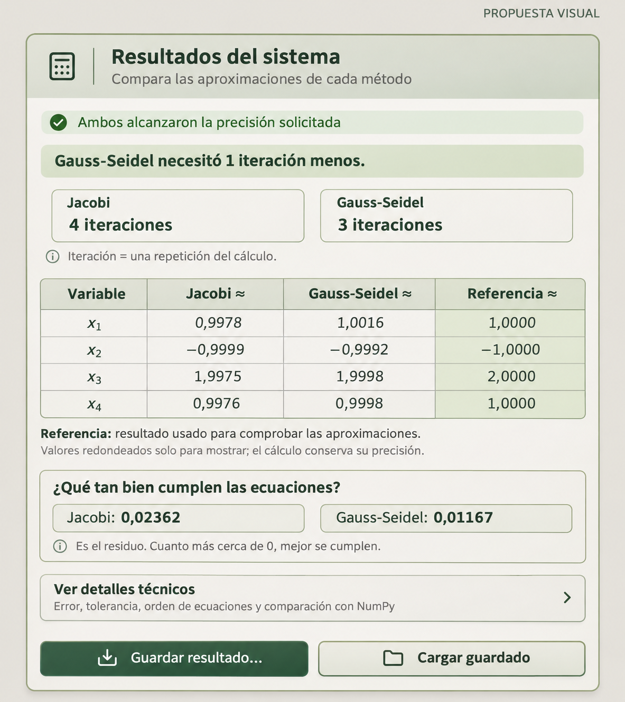

# Resultados más fáciles de leer

Propuesta del 17 de noviembre de 2026, planificada en [#32](https://github.com/ReynaldoZr/AlgebraCalcuadora/issues/32). Implementación asignada a Roberto (@roberto7503), revisión humana de Reynaldo.

La mejora afecta a la tarjeta de resultados: comparar aproximaciones en una tabla, separar referencia y residuo, acortar los números solo al mostrar y mantener los detalles técnicos disponibles. Las advertencias críticas deben permanecer visibles. Conservar las tres tarjetas y la navegación actual.

Las imágenes son maquetas generadas por IA, no capturas de la calculadora ni pruebas numéricas. Los valores y recuentos definitivos salen de los cálculos reales; la imagen no determina la cantidad de pasos. NumPy proporciona una referencia aproximada, no un valor real exacto por definición.

## Vista completa de la calculadora

## Detalle de la tarjeta

Ver criterios, datos de comprobación y pruebas de Windows en la issue. Esta publicación solo conserva las referencias; no implementa el rediseño ni cambia los algoritmos.
